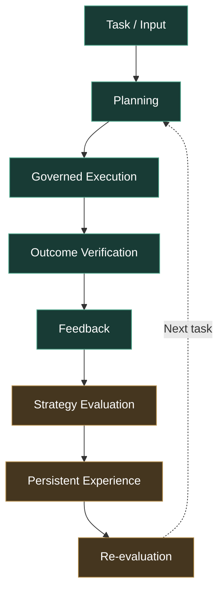

# SKYNET

### ASI-Oriented Cognitive Engineering Research

**CYBERDYNE SYSTEMS** · Autonomous planning · Governed execution · Persistent state · Verifiable adaptation

[Website](https://cyberdynesystem.cc/) · [SKYNET V3](SKYNET%20V3/README.md) · [Architecture](SKYNET%20V3/docs/architecture/ARCHITECTURE.md) · [Research evidence](SKYNET%20V3/docs/research/RESEARCH-STATUS.md) · [Security](SECURITY.md)

> **Research prototype — November 2026.** SKYNET is an executable, ASI-oriented research program, **not an achieved AGI or ASI system**. Cognitive improvement beyond strong static baselines has **not** yet been established.

## Mission

Our long-term objective is the engineering realization of **Artificial Superintelligence (ASI)** through progressively stronger, independently testable cognitive capabilities. Rather than relying on demonstrations alone, SKYNET builds and evaluates the foundations of autonomous reasoning and action: planning, bounded execution, verification, feedback, persistent experience and safe adaptation.

## SKYNET V3 — What Works Today

Within a constrained research domain, SKYNET can construct feasible plans, execute through governed interfaces, respond to resource and scheduling perturbations, attempt local repair or full replanning, check outcomes against explicit constraints, and restore versioned research state across processes. Experimental components can synthesize candidate methods and update strategy evaluations after feedback.

| Capability | Evidence-based status |
| --- | --- |
| Constrained task planning | **Implemented and internally tested** |
| Governed execution and resource limits | **Implemented and internally tested** |
| Perturbation handling, local repair and replanning | **Implemented and internally tested** |
| Outcome verification and safe rejection | **Implemented and internally tested** |
| Deterministic replay and cross-process state restoration | **Verified in bounded internal tests** |
| Candidate-method synthesis and execution | **Experimental implementations; bounded demonstrations** |
| Feedback-conditioned changes in strategy choice | **Observed in a limited pilot** |
| Reliable improvement on unseen tasks | **Not demonstrated** |
| Cross-family transfer and safe continual learning | **Not qualified** |

### Cognitive research loop



**Diagram scope:** stages in green have supporting bounded engineering evidence; amber stages remain experimental or incompletely qualified. This diagram is an architectural research model, **not** proof of one independently qualified end-to-end learning loop.

### Measured engineering results

| Investigation | Internal result | Interpretation |
| --- | --- | --- |
| Deterministic reproducibility | **24/24 matching results** | Limited independent-process semantic comparison |
| Planning/adaptation pilot | **40/52 successful tasks** | Same success count for fixed baseline and learned candidate |
| Candidate synthesis | **16 new AST forms** | Generation demonstrated; useful skill acquisition not established |
| Historical neighborhood selection headroom | **0/38 observed improvements** | No demonstrated advantage over the strongest fixed method in that tested space |
| Session 22 P2 regression partition | **140/140 passing tests** | Internal engineering tests, **not** independent cognitive qualification |

An earlier bounded pilot also observed subsequent method choice changing after a failed method received negative feedback. This is **behavioral adaptation under test conditions**, not evidence of generalizable learning superiority.

**Current research priority:** test whether a larger, predefined set of repair strategies offers measurable *headroom* for task-conditioned selection before building a new learning selector. The headroom precondition is not yet validated.

[Technical details and limitations](SKYNET%20V3/docs/research/RESEARCH-STATUS.md) · [Public code map](SKYNET%20V3/docs/architecture/PUBLIC-CODE-MAP.md)

## Qualification Gates

| Research gate | Status |
| --- | --- |
| L1 — Reproducibility | Limited internal supporting evidence |
| L2 — Persistence | Limited internal supporting evidence |
| L3 — Behavioral improvement | **Not qualified** |
| L4 — Transfer | **Not qualified** |
| L5 — Statistical improvement | **Not qualified** |
| L6 — Safe improvement | **Not qualified** |
| Security 002B | **Open** |
| P2 | **Active; full qualification pending** |
| P3 | **Not authorized** |

## Version History & Repository Layout

| Path | Research scope |
| --- | --- |
| [`SKYNET V1`](SKYNET%20V1/) | Historical V1 cognitive, agent, learning, runtime and validation programs |
| [`SKYNET V2`](SKYNET%20V2/) | Selected V2 public integration source and tests |
| **[`SKYNET V3`](SKYNET%20V3/)** | **Current public engineering utilities, examples, research reports and verification tests** |
| [`tools`](tools/) | Supporting public tooling |

V1 was developed through a historical 64-stage engineering program. V1.1 strengthened the operational runtime. V2 integrated bounded cognitive execution with scheduling, recovery and supervision. These milestones document functional engineering progress; **they are not independent intelligence qualification**. Historical V1.1 and V2 internal testing is described in the repository's research history.

### Run the public V3 tests

From the repository root:

```bash
PYTHONPATH="$PWD/SKYNET V3:$PWD" \
python3 -m unittest discover -s "SKYNET V3/tests" -p 'test_*.py' -v
```

Public tests cover **published engineering utilities and examples only**. They do not reproduce the private Cognitive Core or internal P2 benchmarks.

## Next: Reproducible Cognitive Proof of Concept

Our next demonstrable milestone is an end-to-end trace connecting **Planning → Execution → Verification → Feedback → Behavioral Adaptation → Persistent State → Re-evaluation**, with independent replay and strong fixed-strategy controls. An attractive interface is secondary to reproducible behavior and honest limitations.

**Research roadmap:** [V3 Roadmap](SKYNET%20V3/ROADMAP.md) · [Architecture](SKYNET%20V3/docs/architecture/ARCHITECTURE.md) · [Public examples](SKYNET%20V3/examples/)

## Public Disclosure & Security

The repository is a **selective public release**. The complete private cognitive implementation, protected P1/P2 source, internal evaluation harness, training artifacts and operational secrets are not provided here. Please see [SECURITY.md](SECURITY.md) for responsible reporting guidance. The public license applies only as specified in [LICENSE](LICENSE), subject to relevant third-party terms.

## Support Independent Research

Voluntary Bitcoin support for independent engineering and reproducible cognitive research is welcome.

**BTC mainnet:** `bc1qrxegtdynmn2rnhnu24gqvljlsxn83h5jhhwkk9`

Send **native BTC on Bitcoin mainnet only**. Verify the entire address before sending. Contributions do not confer equity, ownership, governance or investment rights.

**CYBERDYNE SYSTEMS** · [cyberdynesystem.cc](https://cyberdynesystem.cc/)
