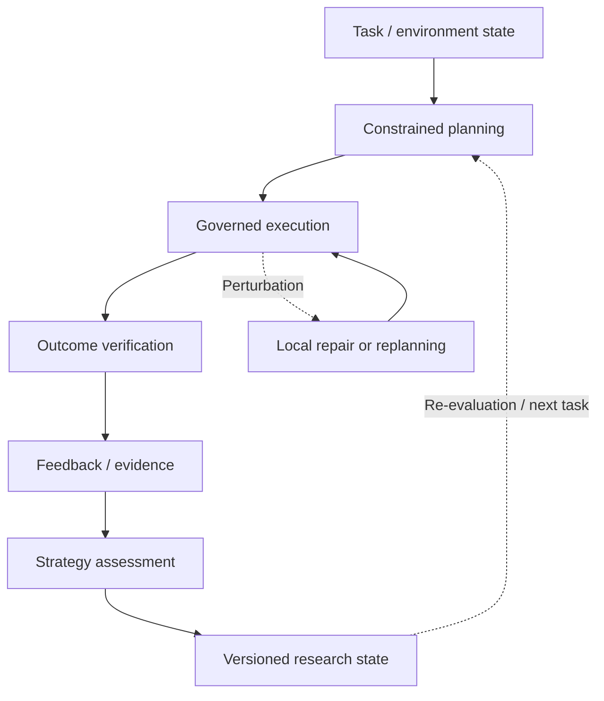

# SKYNET V3 — Cognitive Research Architecture

**CYBERDYNE SYSTEMS** · Public architecture summary · 24 November 2026

## Research objective

Develop and evaluate bounded cognitive mechanisms relevant to a long-term ASI-oriented engineering program. The immediate technical goal is a **reproducible, safely governed cognitive loop**, not a claim of AGI/ASI achievement.

## Functional model

The model combines components that have different evidence levels. It is **not an independently qualified single end-to-end cognitive system**.

## Implemented internal engineering foundations

| Subsystem | Bounded capability | Evidence boundary |
| --- | --- | --- |
| Planning | Builds constrained task plans | Internal functional tests |
| Execution | Uses governed interfaces and explicit budgets | Internal functional tests |
| Replanning | Responds to perturbations; tries local repair or full re-solve | Internal functional tests |
| Verification | Checks outcomes and rejects invalid states | Internal functional tests |
| Persistence | Versioned snapshots, restoration and integrity checks | Limited cross-process evidence |
| Candidate methods | Generate/evaluate candidate strategies | Experimental; no qualified improvement |
| Feedback | Observed change in next method selection after negative feedback | Narrow pilot only |

## Why verification matters

A test passing confirms the scoped property it was written to check. It does not imply that a strategy was learned, improved generalization or demonstrated autonomous intelligence. Private qualification requires matched baselines, prior protocol registration, independence of held-out evaluation and safety gates.

## P2 current research question

Can task features available **before execution** select among supported repair strategies more effectively than a strong **fixed configuration**, under equivalent safety and resource conditions?

The proposed larger strategy search has **not passed** its headroom precondition. The research program must measure headroom **before** implementing another learner.

## Public boundary

This document summarizes architecture without disclosing protected P1/P2 code, policy bindings, private training data or internal evidence archives. See [public code map](PUBLIC-CODE-MAP.md) and [research status](../research/RESEARCH-STATUS.md).
